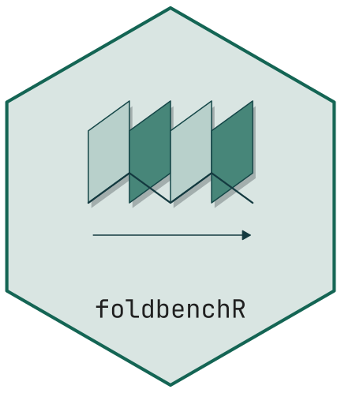

# foldbenchR 

A standalone R package for dimension-reduction benchmarks built from finite
Miura sheets. Sample a folded surface, retain the matching flat material
coordinates, and compare reconstructions and neighbourhoods against them.

The supported folding mechanism is Miura-ori. Yoshimura is available as a flat
triangular pattern for inspection; Yoshimura folding and waterbomb geometry are
research tasks, not implemented benchmark families. See [the roadmap](ROADMAP.md).

## Install and run

Requires R 4.1 or newer, with CRAN packages ggplot2, rlang and vegan. From a clone:

```sh
Rscript --vanilla -e 'install.packages(c("ggplot2", "rlang", "vegan"), repos="https://cloud.r-project.org")'
R CMD INSTALL .
Rscript --vanilla -e 'source(system.file("examples", "benchmark.R", package="foldbenchR"))'
```

```r
library(foldbenchR)
p <- miura_ori(n_rows = 4, n_cols = 6, a = 1, b = 1, alpha = pi/3)
m <- sample_manifold(p, theta = 0.6, n = 200, seed = 42)
y <- prcomp(m$X)$x[, 1:2]
reconstruction_error(y, m$truth)
trustworthiness(m$truth, y, k = 10)
plot_crease(p)
```

`theta` is a normalised folding parameter: 0 is flat, 1 is fully folded and
self-overlapping. Use values below 1 for manifold benchmarks. It is not a
radian dihedral angle. `fold()` returns the corresponding corrugation angle.

## What the benchmark establishes

All facet distances and angles are preserved by the Miura map. The known truth
is the flat material coordinate of each sample, not the output of another
embedding algorithm. On a finite non-convex sheet, flat Euclidean distances need
not equal shortest paths constrained to that sheet. The package models ideal
zero-thickness panels, not material stiffness, thickness or collision mechanics.

`fold_product()` combines independently sampled sheets; `lift()` applies a
random orthonormal map and preserves ambient distances. Distinct independent
samples are necessary to interpret a product as having the full product
intrinsic dimension. Ambient and outlier noise retain the clean latent truth;
reflected material noise remains within the finite sheet. See function help.

Rank metrics use deterministic row-order tie breaking and quadratic memory/time
in sample size. Start with a few hundred points. `short_circuit_theta()` is a
sample-dependent median-distance heuristic, not a universal failure threshold.

## Development and migration

```sh
Rscript --vanilla -e 'install.packages(c("testthat", "roxygen2"), repos="https://cloud.r-project.org")'
Rscript --vanilla -e 'testthat::test_local(stop_on_failure=TRUE)'
R CMD build .
R CMD check --no-manual foldbenchR_0.2.0.tar.gz
```

Version 0.2 replaces the prototype's accordion map. Previous numerical results
must be recomputed: there is no valid angle conversion from that different
mechanism. `theta` now spans `[0,1]`; Miura `b` is the facet side length, not row
height (old flat height `h` corresponds to `b=h/sin(alpha)`). Existing row/column
vertex ordering is retained. Boundary labels are now `B`, facets are explicit,
Yoshimura has real triangular faces and unassigned (`U`) interior edges, and
unsupported folds fail. Regenerate figures and records from saved inputs.

[Geometry and provenance](GEOMETRY.md) records the map and validation criteria.
[Maintenance evidence](MAINTENANCE.md) distinguishes local checks from release
acceptance. Package code is MIT, copyright R. Heller.
